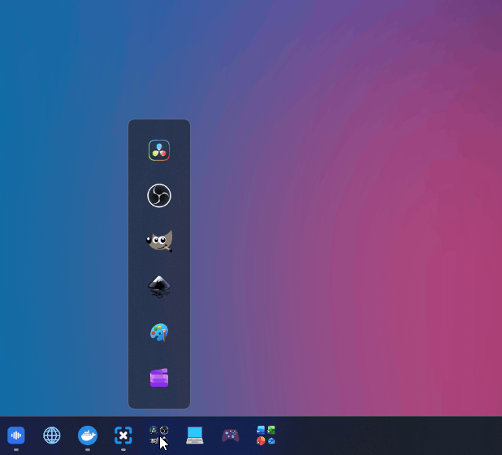
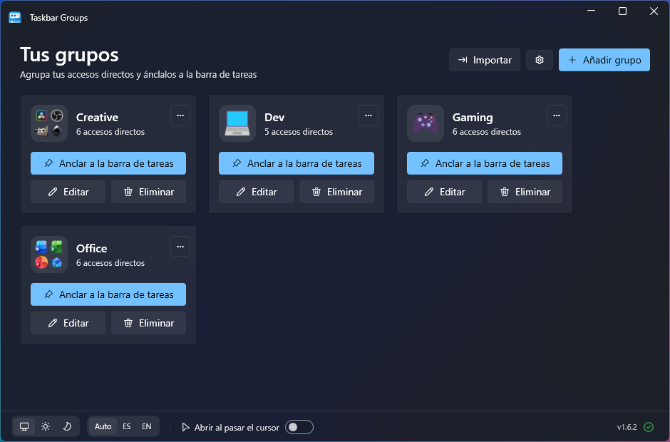
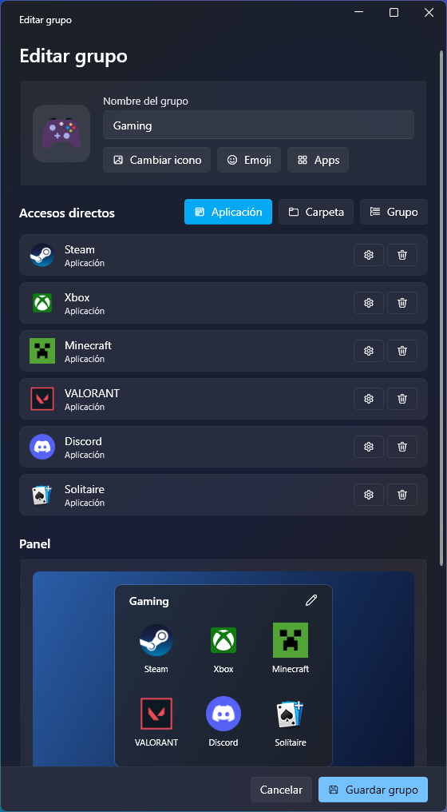

<div align="center">


# Taskbar Groups Fluent

**Agrupa tus accesos directos en un solo icono de la barra de tareas.** Una reescritura moderna en **WPF / .NET 10** de Taskbar Groups, con interfaz Fluent (estilo WinUI 3).

🌍 Español · [English](README.md) · Web: **[tbgf.munito.dev](https://tbgf.munito.dev)**

<p>
  <a href="https://github.com/Mun1to/TaskbarGroupsFluent/releases/latest">
    
  </a>
  <a href="LICENSE">
    
  </a>
  
</p>

<p align="center">
  <a href="https://github.com/Mun1to/TaskbarGroupsFluent/releases/latest/download/TaskbarGroupsFluent-Setup.exe">
    
  </a>
</p>



<sub>Grabado en una barra de tareas real de Windows 11: cuatro grupos, cada uno con su forma de panel.</sub>

</div>

## ✨ Qué hace

Cada grupo se convierte en **un solo botón de la barra de tareas**. Al pulsarlo se abre encima un pequeño panel con todas las apps del grupo.

- 🧩 **Cualquier app instalada**, de escritorio o de Microsoft Store, además de carpetas e incluso otros grupos.
- 🎨 **Icono del grupo** con una imagen, un emoji a color o las propias apps del grupo.
- 🪟 **Cristal de Windows 11** en cuatro formas: cuadrícula, fila, columna o lista, con vista previa mientras lo editas.
- 🖱️ **Abrir al pasar el cursor**, sin hacer clic (viene apagado).
- 📋 **Clic derecho en un grupo anclado** para **Abrir todas** y **Editar grupo**.
- ⚙️ **Opciones por app**: cambiarle el nombre, pasarle argumentos o abrirla como administrador.
- 💾 **Exporta, importa y duplica** grupos, o tráelos de Taskbar Groups o de AppGroup.
- 🌗 **Claro u oscuro, español o inglés**: sigue a Windows, o lo eliges en la barra rápida.
- ⬇️ **Se actualiza sola** cuando sale una versión nueva, si tú le dices que sí.

## 📸 Capturas

| Tus grupos | Editor de grupo |
| :--: | :--: |
|  |  |

## ⬇️ Instalación

1. Descarga **[TaskbarGroupsFluent-Setup.exe](https://github.com/Mun1to/TaskbarGroupsFluent/releases/latest/download/TaskbarGroupsFluent-Setup.exe)** y ejecútalo. Se instala solo para tu usuario y descarga el **.NET 10 Desktop Runtime** si falta.
2. Abre **Taskbar Groups** desde el menú Inicio.

> ¿Ese PC no tiene internet? `TaskbarGroupsFluent-Setup-Offline.exe`, en la [página de Releases](https://github.com/Mun1to/TaskbarGroupsFluent/releases/latest), lleva .NET dentro. Si Windows avisa de un *"editor desconocido"*, pulsa **Más información → Ejecutar de todas formas**: la app no está firmada con un certificado de pago.

## 🚀 Cómo se usa

1. Pulsa **Añadir grupo**, ponle nombre e icono, y añade apps con **Aplicación**, **Carpeta** o **Grupo**.
2. Elige cómo se ve el panel en **Panel** y pulsa **Guardar grupo**.
3. Pulsa **Anclar a la barra de tareas**: la app abre la carpeta con el acceso resaltado, y tú haces clic derecho en él, luego *Mostrar más opciones* y luego *Anclar a la barra de tareas*. Windows 11 no deja que las apps se anclen solas.

## 🛠️ Compilar desde el código

Requiere el [.NET 10 SDK](https://dotnet.microsoft.com/download/dotnet/10.0). Ejecuta `dotnet build TaskbarGroupsFluent.sln -c Release` y arranca `TaskbarGroups.App`. La carpeta que empaqueta el instalador sale de:

```bash
dotnet publish src/TaskbarGroups.App -c Release -r win-x64 --self-contained false -o dist/TaskbarGroupsFluent
dotnet publish src/TaskbarGroups.Hover -c Release -r win-x64 --self-contained false -o dist/TaskbarGroupsFluent
dotnet publish src/TaskbarGroups.Background -c Release -r win-x64 --self-contained false -o dist/TaskbarGroupsFluent/Background
```

El instalador se genera con [Inno Setup](https://jrsoftware.org/isinfo.php) a partir de [`installer/TaskbarGroupsFluent.iss`](installer/TaskbarGroupsFluent.iss). `TaskbarGroups.Core` lleva la lógica, `TaskbarGroups.App` la ventana principal y el editor, `TaskbarGroups.Background` el panel, y `TaskbarGroups.Hover` el vigilante opcional para abrir al pasar el cursor.

## 🙏 Créditos

Construido sobre [tjackenpacken/taskbar-groups](https://github.com/tjackenpacken/taskbar-groups), la app original, y [PikeNote/taskbar-groups-pike-beta](https://github.com/PikeNote/taskbar-groups-pike-beta), el fork de la comunidad del que partió esta reescritura. Usa [WPF-UI](https://github.com/lepoco/wpfui) y [SkiaSharp](https://github.com/mono/SkiaSharp).

## 🔍 No te fíes, compruébalo

El código abierto solo sirve si alguien lo lee, y casi nadie lo hace. Así que en vez de
pedirte que te fíes de este proyecto, aquí tienes el texto para comprobarlo: pásaselo a tu
propia IA junto con este repositorio y en unos minutos tendrás un informe de seguridad en tu
idioma, aunque no sepas programar.

**[Abre AI-AUDIT.md](AI-AUDIT.md)** y pégalo en Claude Code, Codex, Cursor, Copilot o lo que
uses. Es el mismo texto en todos los repositorios públicos de aquí, así que puedes comparar.

## 📜 Licencia

[MIT](LICENSE), igual que los proyectos de arriba.
