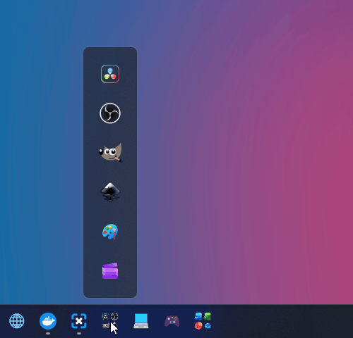
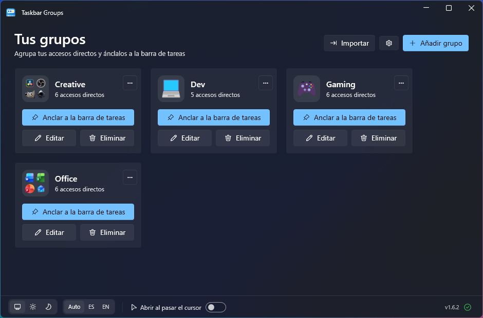
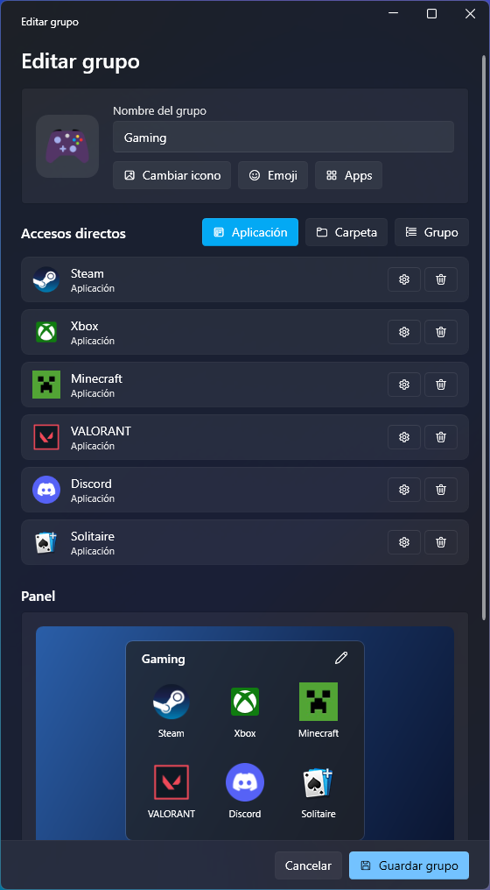

<div align="center">


# Taskbar Groups Fluent

**Agrupa tus accesos directos en un solo icono de la barra de tareas.**

Una reescritura moderna en **WPF / .NET 10** de Taskbar Groups, con interfaz Fluent (estilo WinUI 3).

<a href="https://github.com/Mun1to/TaskbarGroupsFluent/releases/latest/download/TaskbarGroupsFluent-Setup.exe"><picture><source media="(prefers-color-scheme: dark)" srcset=".github/readme/download-windows-dark.es.svg"></picture></a>
<a href="https://apps.microsoft.com/detail/9PCZDXWFT6SN?mode=direct"></a>

Windows 10 / 11 x64 · Gratis · [Licencia MIT](LICENSE)

[Web](https://tbgf.munito.dev) · [Página de Releases](https://github.com/Mun1to/TaskbarGroupsFluent/releases/latest) · [Invítame a un café](https://buymeacoffee.com/munito) · [English](README.md)

</div>

<table>
<tr>
<th align="center">Haz clic en un grupo</th>
<th align="center">O deja el cursor encima</th>
</tr>
<tr>
<td align="center" width="50%"></td>
<td align="center" width="50%"></td>
</tr>
</table>

<p align="center">Grabado en una barra de tareas real de Windows 11. <strong>Abrir al pasar el cursor</strong> viene apagado; se enciende en la barra rápida. Vídeos: <a href="docs/screenshots/panel-click.mp4">clic</a>, <a href="docs/screenshots/panel-hover.mp4">pasar el ratón</a>. <a href="https://tbgf.munito.dev">Demo en la web</a></p>

## Cómo funciona

<p align="center"><picture>
<source media="(prefers-color-scheme: dark) and (max-width: 600px)" srcset=".github/readme/how-it-works-dark-narrow.es.svg">
<source media="(max-width: 600px)" srcset=".github/readme/how-it-works-light-narrow.es.svg">
<source media="(prefers-color-scheme: dark)" srcset=".github/readme/how-it-works-dark.es.svg">

</picture></p>

## Qué hace

Cada grupo se convierte en **un solo botón de la barra de tareas**. Al pulsarlo se abre encima un pequeño panel con todas las apps del grupo.

- **Cualquier app instalada**, de escritorio o de Microsoft Store, además de carpetas e incluso otros grupos, que se abren al lado del panel como un submenú.
- **Una carpeta como grupo**: el panel enseña lo que hay en una carpeta cada vez que se abre, también lugares de Windows como el Panel de control, Este equipo o todas tus apps, y las carpetas de dentro se abren al lado del panel.
- **Toda una barra desde un grupo**: un grupo que lleva otros dentro los ancla todos, uno tras otro, en su orden y con separadores en la barra donde tiene líneas. Windows sigue pidiendo tu clic derecho en cada uno, y la app te va guiando.
- **Separadores** en la barra de tareas, para separar tus grupos del resto de iconos anclados, y dentro del panel, para dividir sus apps en partes con un título si quieres.
- **Arrastrar y soltar** archivos, carpetas y accesos directos desde el Explorador o el escritorio al editor del grupo o a un panel abierto.
- **Todos tus monitores**: el panel se abre encima del icono que pulsaste, en esa pantalla.
- **Junto al reloj** también, si quieres: un grupo tiene su propio icono en la zona de notificaciones, y un clic ahí abre su panel.
- **Icono del grupo** con una imagen, un emoji a color o las propias apps del grupo.
- **Cristal de Windows 11** en cuatro formas: cuadrícula, fila, columna o lista, con vista previa mientras lo editas. En Windows 10 el panel es opaco, como sus propios menús.
- **Sale de detrás de la barra** como el menú Inicio, o asoma, si quieres (viene apagado).
- **Abrir al pasar el cursor**, sin hacer clic, o **abrir al instante**, con un panel preparado para que hasta el primer clic tras encender Windows sea rápido (los dos vienen apagados).
- **Clic derecho en un grupo anclado** para **Abrir todas**, **Editar grupo** o la propia app, o **en una app del panel** para su menú de Windows.
- **Opciones por app**: cambiarle el nombre, pasarle argumentos o abrirla como administrador.
- **Exporta, importa y duplica** grupos, o tráelos de Taskbar Groups o de AppGroup.
- **Claro u oscuro, en español, inglés o ruso**: sigue a Windows, o lo eliges en la barra rápida.
- **Se actualiza sola** cuando sale una versión nueva, si tú le dices que sí.

## Capturas

<table>
<tr>
<td width="50%" valign="top"><br>Tus grupos</td>
<td width="50%" valign="top"><br>Editor de grupo</td>
</tr>
</table>

## Instalación

1. Descarga **[TaskbarGroupsFluent-Setup.exe](https://github.com/Mun1to/TaskbarGroupsFluent/releases/latest/download/TaskbarGroupsFluent-Setup.exe)** y ejecútalo. Se instala solo para tu usuario y descarga el **.NET 10 Desktop Runtime** si falta.
2. Abre **Taskbar Groups** desde el menú Inicio.

Funciona en Windows 11 y en Windows 10 versión 1809 o posterior, de 64 bits.

> ¿Prefieres la Store? **[Consíguelo en la Microsoft Store](https://apps.microsoft.com/detail/9PCZDXWFT6SN?mode=direct)**: la misma app, firmada por Microsoft y actualizada por el propio Windows. Puede ir una versión por detrás del instalador mientras Microsoft revisa cada actualización.

<details>
<summary><b>¿Ese PC no tiene internet?</b></summary>

`TaskbarGroupsFluent-Setup-Offline.exe`, en la [página de Releases](https://github.com/Mun1to/TaskbarGroupsFluent/releases/latest), lleva .NET dentro. Si Windows avisa de un *"editor desconocido"*, pulsa **Más información > Ejecutar de todas formas**: la app no está firmada con un certificado de pago.

</details>

## Apoyar el proyecto

Taskbar Groups Fluent es gratis y no tiene versión de pago. Si te ahorra tiempo, puedes [invitarme a un café](https://buymeacoffee.com/munito) (la app tiene el mismo botón en su barra de abajo y en **Ajustes**), y una estrella en el repo ayuda a que más gente lo encuentre.

## No te fíes, compruébalo

El código abierto solo sirve si alguien lo lee, y casi nadie lo hace. Así que en vez de
pedirte que te fíes de este proyecto, aquí tienes el texto para comprobarlo: pásaselo a tu
propia IA junto con este repositorio y en unos minutos tendrás un informe de seguridad en tu
idioma, aunque no sepas programar.

**[Abre AI-AUDIT.md](AI-AUDIT.md)** y pégalo en Claude Code, Codex, Cursor, Copilot o lo que
uses. Es el mismo texto en todos los repositorios públicos de aquí, así que puedes comparar.

<details>
<summary><b>Compilar desde el código</b></summary>

Requiere el [.NET 10 SDK](https://dotnet.microsoft.com/download/dotnet/10.0). Ejecuta `dotnet build TaskbarGroupsFluent.sln -c Release` y arranca `TaskbarGroups.App`. La carpeta que empaqueta el instalador sale de:

```bash
dotnet publish src/TaskbarGroups.App -c Release -r win-x64 --self-contained false -o dist/TaskbarGroupsFluent
dotnet publish src/TaskbarGroups.Hover -c Release -r win-x64 --self-contained false -o dist/TaskbarGroupsFluent
dotnet publish src/TaskbarGroups.Background -c Release -r win-x64 --self-contained false -o dist/TaskbarGroupsFluent/Background
```

El instalador se genera con [Inno Setup](https://jrsoftware.org/isinfo.php) a partir de [`installer/TaskbarGroupsFluent.iss`](installer/TaskbarGroupsFluent.iss). `TaskbarGroups.Core` lleva la lógica, `TaskbarGroups.App` la ventana principal y el editor, `TaskbarGroups.Background` el panel, y `TaskbarGroups.Hover` el programa opcional junto al reloj, para abrir al pasar el cursor, los grupos junto al reloj y abrir al instante.

</details>

## Licencia

[MIT](LICENSE), igual que los proyectos de arriba.

<details>
<summary><b>Créditos</b></summary>

|  |  |
|---|---|
| [**tjackenpacken/taskbar-groups**](https://github.com/tjackenpacken/taskbar-groups) | Construido sobre ella, la app original. |
| [**PikeNote/taskbar-groups-pike-beta**](https://github.com/PikeNote/taskbar-groups-pike-beta) | El fork de la comunidad del que partió esta reescritura. |
| [**WPF-UI**](https://github.com/lepoco/wpfui) | Lo usa esta app. |
| [**SkiaSharp**](https://github.com/mono/SkiaSharp) | Lo usa esta app. |

</details>

<br>

<p align="center">Hecho por <a href="https://munito.dev"><b>Munir Torres</b></a>. También suyo: <a href="https://adeorq.com">Adeorq</a> · <a href="https://vocript.app">VoCript</a> · <a href="https://winshotx.com">winshotx</a> · <a href="https://github.com/Mun1to/Expoal">Expoal</a> · <a href="https://github.com/Mun1to/hotkeyconfig">hotkeyconfig</a> · <a href="https://github.com/Mun1to/froede">froede</a></p>
