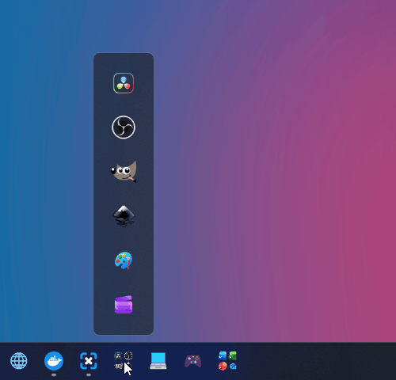
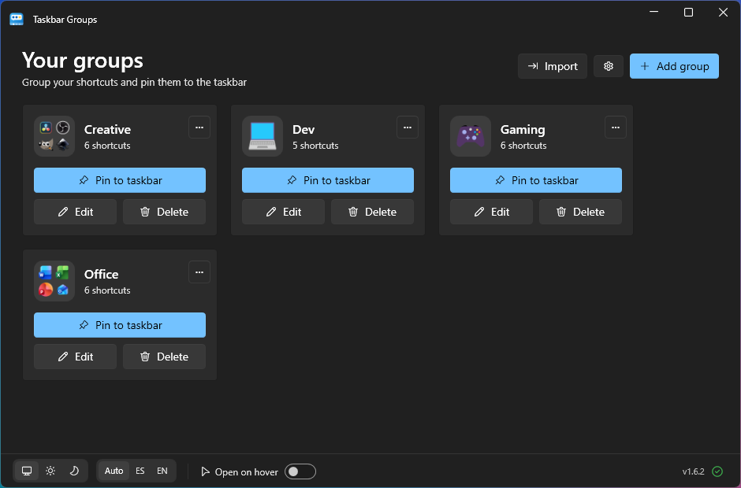
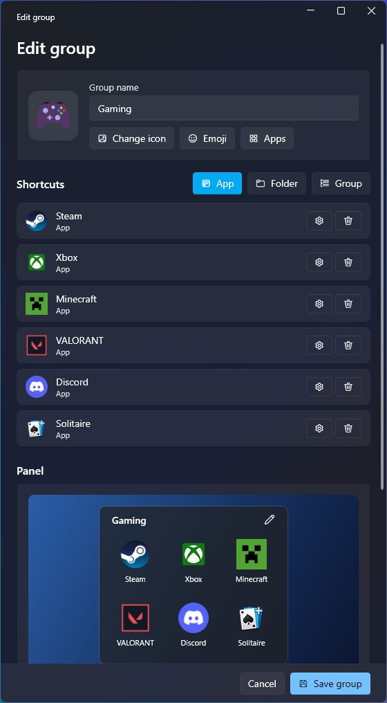

<div align="center">


# Taskbar Groups Fluent

**Group your shortcuts into a single taskbar icon.**

A modern **WPF / .NET 10** rewrite of Taskbar Groups, with a Fluent (WinUI 3-style) interface.

<a href="https://github.com/Mun1to/TaskbarGroupsFluent/releases/latest/download/TaskbarGroupsFluent-Setup.exe"><picture><source media="(prefers-color-scheme: dark)" srcset=".github/readme/download-windows-dark.svg"></picture></a>
<a href="https://apps.microsoft.com/detail/9PCZDXWFT6SN?mode=direct"></a>

Windows 10 / 11 x64 · Free · [Licence MIT](LICENSE)

[Website](https://tbgf.munito.dev) · [Releases page](https://github.com/Mun1to/TaskbarGroupsFluent/releases/latest) · [Buy me a coffee](https://buymeacoffee.com/munito) · [Español](README.es.md)

</div>

<table>
<tr>
<th align="center">Click a group</th>
<th align="center">Or just rest the cursor on it</th>
</tr>
<tr>
<td align="center" width="50%"></td>
<td align="center" width="50%"></td>
</tr>
</table>

<p align="center">Recorded on a real Windows 11 taskbar. <strong>Open on hover</strong> is off by default; switch it on in the quick bar. Videos: <a href="docs/screenshots/panel-click.mp4">click</a>, <a href="docs/screenshots/panel-hover.mp4">hover</a>. <a href="https://tbgf.munito.dev">Live demo on the website</a></p>

## How it works

<p align="center"><picture>
<source media="(prefers-color-scheme: dark) and (max-width: 600px)" srcset=".github/readme/how-it-works-dark-narrow.svg">
<source media="(max-width: 600px)" srcset=".github/readme/how-it-works-light-narrow.svg">
<source media="(prefers-color-scheme: dark)" srcset=".github/readme/how-it-works-dark.svg">

</picture></p>

## What it does

Each group becomes **one taskbar button**. Click it and a small panel opens above it with every app in the group.

- **Any installed app**, desktop or Microsoft Store, plus folders and even other groups, which open beside the panel like a submenu.
- **A folder as a group**: the panel shows what is in a folder each time it opens, Windows places like the Control Panel, This PC or all your apps included, and the folders inside it open beside the panel.
- **A whole taskbar from one group**: a group that holds other groups pins them all, one after another, in its order and with taskbar separators where it has lines. Windows still wants your right-click for each one, and the app walks you through them.
- **Separators** on the taskbar, to keep your groups apart from the rest of your pinned icons, and inside a panel, to split its apps into sections with an optional title.
- **Drag and drop** files, folders and shortcuts from File Explorer or the desktop onto the group editor or an open panel.
- **Every monitor**: the panel opens over the icon you clicked, on that screen.
- **By the clock** too, if you want: a group gets its own icon in the notification area, and a click there opens its panel.
- **Group icon** from an image, a colour emoji or the group's own apps.
- **Windows 11 glass** in four layouts: grid, row, column or list, with a live preview while you edit. On Windows 10 the panel is solid, like its own menus.
- **Slides out from behind the taskbar** like the Start menu, or peeks up, if you want it to (off by default).
- **Open on hover**, no click needed, or **open instantly**, with a panel kept ready so even the first click after starting Windows is quick (both off by default).
- **Right-click a pinned group** for **Open all**, **Edit group** or the app itself, or **an app in the panel** for its own Windows menu.
- **Per-app options**: rename, launch arguments, run as administrator.
- **Export, import and duplicate** groups, or bring them over from Taskbar Groups or AppGroup.
- **Light or dark, in English, Spanish or Russian**: follows Windows, or pick them in the quick bar.
- **Updates itself** when a new version is out, if you say so.

## Screenshots

<table>
<tr>
<td width="50%" valign="top"><br>Your groups</td>
<td width="50%" valign="top"><br>Group editor</td>
</tr>
</table>

## Install

1. Download **[TaskbarGroupsFluent-Setup.exe](https://github.com/Mun1to/TaskbarGroupsFluent/releases/latest/download/TaskbarGroupsFluent-Setup.exe)** and run it. It installs for your user only and downloads the **.NET 10 Desktop Runtime** if it is missing.
2. Open **Taskbar Groups** from the Start menu.

It runs on Windows 11 and on Windows 10 version 1809 or later, 64-bit.

> Prefer the Store? **[Get it from the Microsoft Store](https://apps.microsoft.com/detail/9PCZDXWFT6SN?mode=direct)**: the same app, signed by Microsoft and kept up to date by Windows. It can lag a version behind the installer while each update is reviewed.

<details>
<summary><b>No internet on that PC?</b></summary>

`TaskbarGroupsFluent-Setup-Offline.exe` on the [Releases page](https://github.com/Mun1to/TaskbarGroupsFluent/releases/latest) carries .NET inside. If Windows warns about an *"unknown publisher"*, click **More info > Run anyway**: the app isn't signed with a paid certificate.

</details>

## Support

Taskbar Groups Fluent is free and has no paid version. If it saves you time, you can [buy me a coffee](https://buymeacoffee.com/munito) (the app has the same button in its bottom bar and in **Settings**), and a star on the repo helps more people find it.

## Don't trust it, check it

Published code only helps if somebody actually reads it, and almost nobody does. So
instead of asking you to trust this project, here is the prompt to check it: point your own
AI agent at this repository and get a security report, in your language, in a few minutes,
even if you do not know how to program.

**[Open AI-AUDIT.md](AI-AUDIT.md)** and paste it into Claude Code, Codex, Cursor, Copilot or
whatever you use. It is the same prompt in every public repository here, so you can compare.

> **ES:** No hace falta que te fíes. Abre [AI-AUDIT.md](AI-AUDIT.md), pega ese texto en tu IA
> y te dirá en tu idioma qué hace este programa de verdad: qué envía por internet, qué toca
> en tu ordenador y qué ejecuta al instalarse.

<details>
<summary><b>Building from source</b></summary>

Requires the [.NET 10 SDK](https://dotnet.microsoft.com/download/dotnet/10.0). Run `dotnet build TaskbarGroupsFluent.sln -c Release` and start `TaskbarGroups.App`. The folder the installer packs comes from:

```bash
dotnet publish src/TaskbarGroups.App -c Release -r win-x64 --self-contained false -o dist/TaskbarGroupsFluent
dotnet publish src/TaskbarGroups.Hover -c Release -r win-x64 --self-contained false -o dist/TaskbarGroupsFluent
dotnet publish src/TaskbarGroups.Background -c Release -r win-x64 --self-contained false -o dist/TaskbarGroupsFluent/Background
```

The installer is built with [Inno Setup](https://jrsoftware.org/isinfo.php) from [`installer/TaskbarGroupsFluent.iss`](installer/TaskbarGroupsFluent.iss). `TaskbarGroups.Core` holds the logic, `TaskbarGroups.App` the main window and editor, `TaskbarGroups.Background` the panel, and `TaskbarGroups.Hover` the optional program by the clock, for open on hover, groups by the clock and instant opening.

</details>

## License

[MIT](LICENSE), same as the projects above.

<details>
<summary><b>Credits</b></summary>

|  |  |
|---|---|
| [**tjackenpacken/taskbar-groups**](https://github.com/tjackenpacken/taskbar-groups) | Built on it, the original app. |
| [**PikeNote/taskbar-groups-pike-beta**](https://github.com/PikeNote/taskbar-groups-pike-beta) | The community fork this rewrite started from. |
| [**WPF-UI**](https://github.com/lepoco/wpfui) | Used by this app. |
| [**SkiaSharp**](https://github.com/mono/SkiaSharp) | Used by this app. |

</details>

<br>

<p align="center">Made by <a href="https://munito.dev"><b>Munir Torres</b></a>. Also by him: <a href="https://adeorq.com">Adeorq</a> · <a href="https://vocript.app">VoCript</a> · <a href="https://winshotx.com">winshotx</a> · <a href="https://github.com/Mun1to/Expoal">Expoal</a> · <a href="https://github.com/Mun1to/hotkeyconfig">hotkeyconfig</a> · <a href="https://github.com/Mun1to/froede">froede</a></p>
