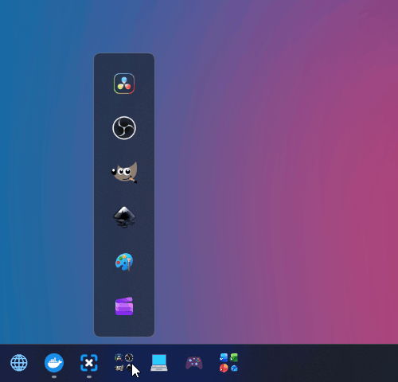
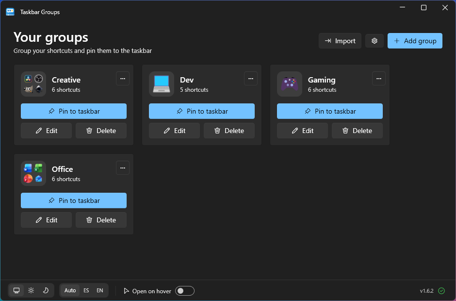
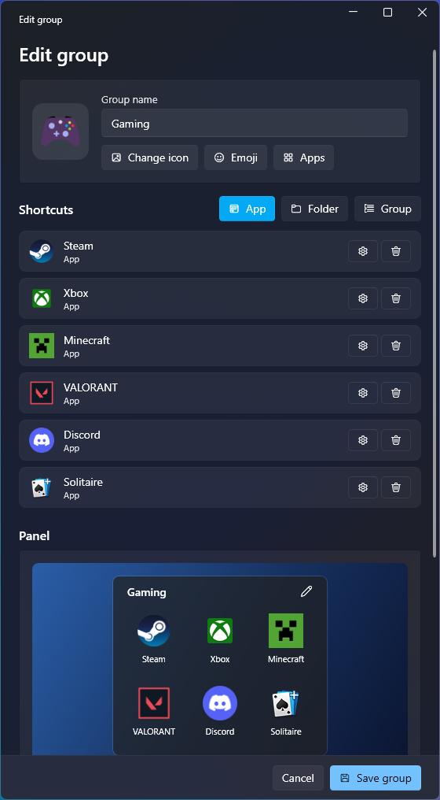

<div align="center">


# Taskbar Groups Fluent

**Group your shortcuts into a single taskbar icon.** A modern **WPF / .NET 10** rewrite of Taskbar Groups, with a Fluent (WinUI 3-style) interface.

🌍 [Español](README.es.md) · English · Website: **[tbgf.munito.dev](https://tbgf.munito.dev)**

<p>
  <a href="https://github.com/Mun1to/TaskbarGroupsFluent/releases/latest">
    
  </a>
  <a href="LICENSE">
    
  </a>
  
  <a href="https://buymeacoffee.com/munito">
    
  </a>
</p>

<p align="center">
  <a href="https://github.com/Mun1to/TaskbarGroupsFluent/releases/latest/download/TaskbarGroupsFluent-Setup.exe">
    
  </a>
</p>

<table>
  <tr>
    <th align="center">Click a group</th>
    <th align="center">Or just rest the cursor on it</th>
  </tr>
  <tr>
    <td align="center"></td>
    <td align="center"></td>
  </tr>
</table>

<sub>Recorded on a real Windows 11 taskbar. <b>Open on hover</b> is off by default; switch it on in the quick bar.<br />▶️ Videos: <a href="docs/screenshots/panel-click.mp4">click</a> · <a href="docs/screenshots/panel-hover.mp4">hover</a> · 🖥️ <a href="https://tbgf.munito.dev">Live demo on the website</a></sub>

</div>

## ✨ What it does

Each group becomes **one taskbar button**. Click it and a small panel opens above it with every app in the group.

- 🧩 **Any installed app**, desktop or Microsoft Store, plus folders and even other groups.
- 🎨 **Group icon** from an image, a colour emoji or the group's own apps.
- 🪟 **Windows 11 glass** in four layouts: grid, row, column or list, with a live preview while you edit.
- 🖱️ **Open on hover**, no click needed (off by default).
- 📋 **Right-click a pinned group** for **Open all** and **Edit group**.
- ⚙️ **Per-app options**: rename, launch arguments, run as administrator.
- 💾 **Export, import and duplicate** groups, or bring them over from Taskbar Groups or AppGroup.
- 🌗 **Light or dark, English or Spanish**: follows Windows, or pick them in the quick bar.
- ⬇️ **Updates itself** when a new version is out, if you say so.

## 📸 Screenshots

| Your groups | Group editor |
| :--: | :--: |
|  |  |

## ⬇️ Install

1. Download **[TaskbarGroupsFluent-Setup.exe](https://github.com/Mun1to/TaskbarGroupsFluent/releases/latest/download/TaskbarGroupsFluent-Setup.exe)** and run it. It installs for your user only and downloads the **.NET 10 Desktop Runtime** if it is missing.
2. Open **Taskbar Groups** from the Start menu.

> No internet on that PC? `TaskbarGroupsFluent-Setup-Offline.exe` on the [Releases page](https://github.com/Mun1to/TaskbarGroupsFluent/releases/latest) carries .NET inside. If Windows warns about an *"unknown publisher"*, click **More info → Run anyway**: the app isn't signed with a paid certificate.

## 🚀 How to use it

1. Click **Add group**, give it a name and an icon, and add apps with **App**, **Folder** or **Group**.
2. Pick the panel's look under **Panel** and click **Save group**.
3. Click **Pin to taskbar**: the app opens the folder with the shortcut highlighted, and you right-click it, then *Show more options*, then *Pin to taskbar*. Windows 11 doesn't let apps pin themselves.

## 🛠️ Building from source

Requires the [.NET 10 SDK](https://dotnet.microsoft.com/download/dotnet/10.0). Run `dotnet build TaskbarGroupsFluent.sln -c Release` and start `TaskbarGroups.App`. The folder the installer packs comes from:

```bash
dotnet publish src/TaskbarGroups.App -c Release -r win-x64 --self-contained false -o dist/TaskbarGroupsFluent
dotnet publish src/TaskbarGroups.Hover -c Release -r win-x64 --self-contained false -o dist/TaskbarGroupsFluent
dotnet publish src/TaskbarGroups.Background -c Release -r win-x64 --self-contained false -o dist/TaskbarGroupsFluent/Background
```

The installer is built with [Inno Setup](https://jrsoftware.org/isinfo.php) from [`installer/TaskbarGroupsFluent.iss`](installer/TaskbarGroupsFluent.iss). `TaskbarGroups.Core` holds the logic, `TaskbarGroups.App` the main window and editor, `TaskbarGroups.Background` the panel, and `TaskbarGroups.Hover` the optional watcher for open on hover.

## 🙏 Credits

Built on [tjackenpacken/taskbar-groups](https://github.com/tjackenpacken/taskbar-groups), the original app, and [PikeNote/taskbar-groups-pike-beta](https://github.com/PikeNote/taskbar-groups-pike-beta), the community fork this rewrite started from. Uses [WPF-UI](https://github.com/lepoco/wpfui) and [SkiaSharp](https://github.com/mono/SkiaSharp).

## 🔍 Don't trust it, check it

Open source only helps if somebody actually reads the code, and almost nobody does. So
instead of asking you to trust this project, here is the prompt to check it: point your own
AI agent at this repository and get a security report, in your language, in a few minutes,
even if you do not know how to program.

**[Open AI-AUDIT.md](AI-AUDIT.md)** and paste it into Claude Code, Codex, Cursor, Copilot or
whatever you use. It is the same prompt in every public repository here, so you can compare.

> **ES:** No hace falta que te fíes. Abre [AI-AUDIT.md](AI-AUDIT.md), pega ese texto en tu IA
> y te dirá en tu idioma qué hace este programa de verdad: qué envía por internet, qué toca
> en tu ordenador y qué ejecuta al instalarse.

## ☕ Support

Taskbar Groups Fluent is free and has no paid version. If it saves you time, you can [buy me a coffee](https://buymeacoffee.com/munito) (the app has the same button in its bottom bar and in **Settings**), and a ⭐ on the repo helps more people find it.

## 📜 License

[MIT](LICENSE), same as the projects above.
